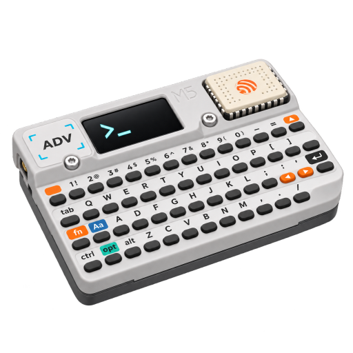

# M5Stack Cardputer-Adv · Ekko Studio



Cardputer-Adv 的 Ekko Studio 配套插件。查看设备连接、通过 USB 升级固件，并查阅首次绑定和按键说明。

当前插件：**0.3.0-alpha.2**；配套固件：**cardputer-adv-v10.0.0-alpha.6**。这是开发版本，当前支持同一局域网使用。

已提交官方插件目录审核，当前等待管理员审核。审核前可以使用上方仓库根地址安装；提交状态和回执见[提交记录](docs/SUBMISSION.zh-CN.md)。

## 使用前准备

- 一台 M5Stack Cardputer-Adv，以及运行官方 Ekko Studio 的电脑。
- M5 与电脑连接同一 Wi-Fi；需要升级时，USB 数据线接运行 Studio 服务的电脑。
- 本包的应用升级只适用于已安装本项目兼容 8MiB 双固件布局的设备。**新机或其他布局不能直接刷这个应用包**，本包不提供完整首刷镜像。

## 安装插件

在 Studio 的「插件中心」安装并启用插件。GitHub 仓库安装取得的版本以实际清单为准，开发分支与默认分支可能不同。

使用本地目录时，先在完整插件目录安装生产依赖，再选择该目录安装：

```sh
npm install --ignore-scripts --omit=dev
```

需要 Node 24 或更新版本。详细步骤见[安装教程](docs/INSTALL.zh-CN.md)。插件已提供成品 JavaScript，无需构建；不修改 Studio 核心或电脑上的 Agent 配置。

## 第一次连接

1. M5 和电脑连接同一 Wi-Fi，在电脑打开 Studio。
2. 从 M5 原厂菜单进入 EkkoStudio。首次在浏览器打开设备显示的地址，选择电脑、登录自己的 Studio 账号并选择 Profile。
3. 回到 M5 选择已在电脑配置好的 Agent，按 OK 进入聊天。已有有效绑定时，不用重复登录。

插件「设备」页显示连接状态，并可保存常用设备和管理入口。聊天由设备直接连接 Studio，不需要一直打开插件页面。

## 日常操作

- 方向键选择 Agent，OK 进入或发送；首页 Tab 选择 Studio 模型或原生 CLI。
- 中文拼音后按空格选词，Ctrl＋空格切换中英文。
- 按住 G0 或 Fn＋空格说话，松开发送；单次最长 5 秒，不依赖 SD 卡。
- Fn＋上／下翻看历史，短按 G0 或 Esc 返回。

实际可用 Agent 取决于电脑上的安装、登录和模型配置。详见[使用说明](docs/QUICKSTART.zh-CN.md)。

## 升级固件

打开插件 **「固件」→「扫描 USB 设备」→选择设备→确认升级**。

插件先保存本机私有完整备份并核对设备布局，再仅更新 Ekko 应用，读回检查原厂和设置区域。写入后保持数据线连接，不要关闭电脑或 Studio。升级结束后，从 M5 原厂菜单进入 EkkoStudio。

完整步骤、备份位置和恢复注意事项见[USB 升级说明](docs/USB_UPDATE.zh-CN.md)。当前没有 OTA、跨网远程或新机首刷功能。

## 版本、源码与反馈

- [固件与兼容范围](docs/FIRMWARE.zh-CN.md)
- [更新记录](CHANGELOG.md)
- [测试与已知问题](docs/VALIDATION.zh-CN.md)
- [提交反馈](https://github.com/thursdaycapital/ekko-studio-plugin-cardputer-adv/issues)

固件应用和对应源码归档随包提供，校验信息见 `firmware/release.json` 与 `firmware/SHA256SUMS.txt`；重新构建和链接见[说明](firmware/RELINK.md)。全部 Agent 与异常恢复的实体矩阵尚未完成，不把当前开发版描述为全功能稳定版。

代码许可、组件和素材来源见 [LICENSE](LICENSE) 与[第三方声明](THIRD_PARTY_NOTICES.md)。私人 Flash 备份、NVS、账号认证信息和原始日志不随包分发。
